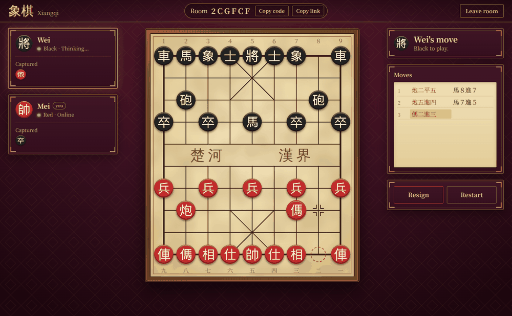
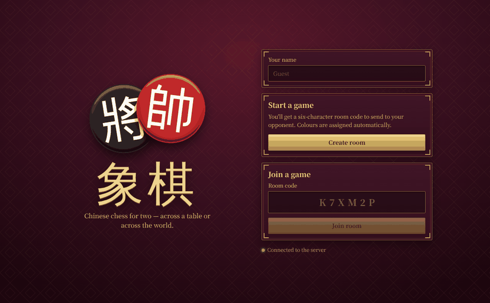

# 象棋 Xiangqi Online

Real-time multiplayer Chinese Chess for two players on different devices, networks or countries.

React + TypeScript client · Node.js + Express server · Socket.IO (WebSockets) · server-authoritative rules



---

## Features

- **Rooms** – create a game and get a 6-character code (`K7XM2P`); a second player enters it to join. Exactly two players per room, a third is turned away.
- **Automatic colours** – the host's colour is random (configurable); the joiner gets the other. Colours swap on every rematch.
- **Server-authoritative** – clients only send *"move piece from A to B"*. The server validates it against the full rules and pushes the resulting state to both players. Illegal moves, out-of-turn moves and moves from outsiders are rejected. Even the highlighted legal-move dots come from the server.
- **Complete Xiangqi rules** – all seven piece types, horse-leg and elephant-eye blocking, cannon screens, river boundary, palace confinement, check, checkmate, stalemate (a loss in Xiangqi), the flying-general rule, pins, perpetual check, threefold repetition and the 60-move no-capture draw.
- **Game UI** – whose turn it is, check warning, captured pieces for both sides, move history in traditional notation (炮二平五), last-move markers, win/loss/draw banner, per-room scoreboard.
- **Resign and restart** – resigning is immediate (with a confirm dialog); restarting needs the opponent's consent.
- **Disconnect / reconnect** – refresh the page or lose your connection and you land back in your seat with the game intact. The opponent sees a live countdown; if you don't return within the grace period (90 s by default) you forfeit.
- **Responsive, traditional look** – dark burgundy lacquer, gold accents, parchment board in a rosewood frame, lacquered discs using the supplied piece artwork. Laptop, tablet and phone layouts.

| | |
|---|---|
|  | Screenshots were taken in a sandbox without internet access, so the Google Fonts brush typeface (Ma Shan Zheng) fell back to a plain serif. On your machine the title and river text use the brush font. |

---

## Project structure

```
xiangqi-online/
├── package.json              npm workspaces root: dev / build / start / test scripts
├── README.md
├── shared/
│   └── protocol.ts           wire protocol types shared by server AND client (types only)
├── server/                   Node.js + Express + Socket.IO
│   ├── package.json
│   ├── tsconfig.json
│   ├── .env.example          ← copy to .env
│   ├── src/
│   │   ├── index.ts          entry point: load .env, listen, print LAN / ngrok hints
│   │   ├── config.ts         env parsing, CORS origin matcher (supports https://*.ngrok-free.app)
│   │   ├── app.ts            Express + Socket.IO setup; also serves the built client
│   │   ├── game/
│   │   │   ├── engine.ts     pure rules engine: move generation, check, flying general
│   │   │   ├── XiangqiGame.ts  one match: turns, history, captures, mate/repetition/draw detection
│   │   │   └── notation.ts   traditional move notation
│   │   ├── rooms/
│   │   │   └── RoomService.ts  rooms, seats, tokens, reconnect/forfeit timers, rematch, cleanup
│   │   ├── socket/
│   │   │   └── registerHandlers.ts  socket events → RoomService (validates every payload)
│   │   └── utils/roomCode.ts
│   └── tests/                48 tests (rules, game flow, rooms, real-socket integration)
└── client/                   React + TypeScript + Vite
    ├── package.json
    ├── tsconfig.json
    ├── vite.config.ts        dev server + /socket.io proxy + ngrok host allow-list
    ├── index.html
    ├── .env.example          ← copy to .env
    ├── public/
    │   ├── favicon.svg
    │   └── pieces/           your artwork: disc-red/black.png and 14 character SVGs
    └── src/
        ├── main.tsx · App.tsx · styles.css
        ├── lib/              socket.ts · session.ts · pieces.ts · geometry.ts · result.ts · clipboard.ts
        ├── hooks/            useGameSession.ts (connection + state) · usePieceIds.ts · useNow.ts
        └── components/       Lobby · GameScreen · Board · PieceIcon · PlayerCard · CapturedRow ·
                              MoveHistory · ResultBanner · ConfirmDialog · Toasts
```

---

## Requirements

- **Node.js 22.12 or newer** (the current LTS) and npm
- For testing across two laptops: a free [ngrok](https://ngrok.com/download) account

---

## Quick start (local)

```bash
npm install          # installs server + client + shared tooling (one command, from the project root)
npm run dev          # starts the server on :3001 and the React dev server on :5173
```

Open **http://localhost:5173** in two browser tabs (or windows).

1. In tab 1 enter a name and press **Create room**. You'll see a 6-character code.
2. In tab 2 enter a name, type the code and press **Join room**.

Each tab is an independent player, so you can test the whole game alone. (The seat is remembered per tab, so a refresh keeps you in your game.)

The `.env` files are optional for this: everything has a working default. To customise, copy the examples:

```bash
cp server/.env.example server/.env
cp client/.env.example client/.env
```

### Other scripts

| Command | What it does |
|---|---|
| `npm run dev` | server (auto-reload) + client (hot reload) together |
| `npm run build` | production build of the client into `client/dist` |
| `npm start` | starts the server; if `client/dist` exists it serves the game on the same port |
| `npm test` | runs the 48 server tests |
| `npm run typecheck` | TypeScript check for server and client |

---

## Playing between two laptops with ngrok

The server can serve the built React app *and* the WebSocket from one port, so **one ngrok tunnel is enough**.

### Option A – single URL (recommended)

On the laptop that will host the server:

```bash
npm install
npm run build                          # builds the client into client/dist
npm start                              # → http://localhost:3001

# one-time ngrok setup (token is on your ngrok dashboard)
ngrok config add-authtoken <YOUR_TOKEN>

# in a second terminal
ngrok http 3001
```

ngrok prints a public address such as `https://abcd-12-34-56.ngrok-free.app`.

1. **Open that address yourself** and create a room. (Use the ngrok address rather than `localhost`: the *Copy link* button builds the invite from the address bar, so it will contain the public URL.)
2. Send the **room code** or the **invite link** to your opponent. They open the ngrok address on their laptop and join.

> **ngrok free tier:** the first visit in each browser shows an ngrok notice page. Click **Visit Site** once and carry on. The client also sends the `ngrok-skip-browser-warning` header for its own requests.

### Option B – dev mode through ngrok

Handy while you're still editing code. The Vite dev server proxies `/socket.io` to the game server and already allows ngrok hostnames:

```bash
npm run dev
ngrok http 5173
```

Share the ngrok address as above.

### Option C – only the backend is tunnelled

If the client runs somewhere else (for example each player runs `npm run dev` locally) and only the server is exposed:

```bash
# server laptop
npm start
ngrok http 3001                        # → https://abcd-12-34-56.ngrok-free.app
```

On every client machine, point the client at that address in `client/.env`, then restart `npm run dev`:

```ini
VITE_SERVER_URL=https://abcd-12-34-56.ngrok-free.app
```

The server only accepts browser connections from origins listed in `CLIENT_ORIGINS` (`localhost:5173` and `*.ngrok*` are allowed by default). If the clients are served from somewhere else, add that origin to `server/.env`.

### Same Wi-Fi, no ngrok

When the server starts it prints its LAN address (for example `http://192.168.1.20:3001`). After `npm run build` and `npm start`, a second laptop on the same network can open that address directly. Note that browsers disable the clipboard API on plain-HTTP addresses, so the *Copy* buttons fall back to an older method that still works in most browsers.

---

## Configuration

### `server/.env`

| Variable | Default | Meaning |
|---|---|---|
| `PORT` | `3001` | HTTP + WebSocket port |
| `HOST` | `0.0.0.0` | interface to bind (`0.0.0.0` makes it reachable from other devices / ngrok) |
| `CLIENT_ORIGINS` | `localhost:5173`, `127.0.0.1:5173`, `https://*.ngrok-free.app`, `…ngrok-free.dev`, `…ngrok.app`, `…ngrok.io` | comma-separated browser origins allowed to connect. `*.` wildcards work for subdomains; `*` allows everything (testing only). Not used when the page is served by the server itself. |
| `SERVE_CLIENT` | `true` | serve `client/dist` from the same port |
| `RECONNECT_GRACE_SECONDS` | `90` | how long a disconnected player has to return before forfeiting (`0` = never) |
| `ROOM_TTL_MINUTES` | `60` | abandoned rooms (nobody connected) are deleted after this long |
| `RANDOM_COLORS` | `true` | `false` makes the room creator always Red |

### `client/.env`

| Variable | Default | Meaning |
|---|---|---|
| `VITE_SERVER_URL` | *(empty)* | Socket.IO server URL. Empty = same origin as the page (Vite proxy in dev, Express in production). Set it to an ngrok URL for Option C. Rebuild or restart after changing. |
| `DEV_PROXY_TARGET` | `http://localhost:3001` | dev only: where Vite forwards `/socket.io` |
| `DEV_ALLOWED_HOSTS` | *(empty)* | dev only: extra Host names Vite should accept (e.g. a reserved ngrok domain) |

---

## How it works

```
 Browser A ─┐                                   ┌─ Browser B
            │  intent: "move 67 → 31"           │
            ▼                                   ▼
        ┌────────────────  Socket.IO  ───────────────┐
        │  registerHandlers  → validates the payload │
        │  RoomService       → seat, turn, status    │
        │  XiangqiGame       → full rules (engine)   │
        └──────────────┬─────────────────────────────┘
                       │  room:update  (validated state, personalised per player)
                       ▼
                both clients re-render
```

**The client never decides anything.** A *RoomView* sent to each player contains the board, whose turn it is, history, captures, result, and `legalMoves` for *that player's own pieces* (empty when it isn't their turn). Clicking a piece just reads that list.

**Squares** are numbers `0–89`: `row * 9 + col`, row 0 = Black's back rank, row 9 = Red's. Each player's board is flipped so their own side is at the bottom.

### Socket events

| Client → server | Payload | Notes |
|---|---|---|
| `room:create` | `{ name }` | returns `{ code, token, color }` |
| `room:join` | `{ code, name }` | `ROOM_NOT_FOUND`, `ROOM_FULL`, `INVALID_CODE` |
| `room:rejoin` | `{ code, token }` | reclaim your seat after a refresh/reconnect |
| `room:leave` | – | leaving a game in progress counts as a resignation |
| `game:move` | `{ from, to }` | `NOT_YOUR_TURN`, `ILLEGAL_MOVE`, `GAME_NOT_ACTIVE` |
| `game:resign` | – | |
| `game:restart:request` / `:respond` | `{ accept }` | restart needs the opponent's consent; colours swap |

| Server → client | Meaning |
|---|---|
| `room:update` | the full validated state (sent after every change) |
| `room:notice` | short messages ("Bob lost connection…", "Your opponent declined to restart") |
| `room:replaced` | the same seat was claimed from another tab/device |

Every client → server event is acknowledged with `{ ok: true, … }` or `{ ok: false, error, message }`.

### Reconnection

- On create/join the server hands out a secret **seat token**. The browser keeps it in `sessionStorage`, so a refresh or a dropped connection reclaims the same seat via `room:rejoin`.
- When a socket drops, the seat is kept, the opponent sees *"Offline – forfeits in 1:23"* and a timer starts. Returning in time cancels it; otherwise the game is awarded to the opponent (`RECONNECT_GRACE_SECONDS`).
- If a tab is closed, the lobby of a fresh tab offers an opt-in **Resume game** button (for up to an hour).
- Opening the same seat in a second tab takes it over; the old tab is told so.
- Game state lives in server memory. Restarting the server ends all games (players are returned to the lobby).

### Rules notes

- No legal move = loss (checkmate **or** stalemate), as in Xiangqi.
- A move that would leave your own general attacked, or let the two generals face each other on an open file, is illegal.
- *Threefold repetition* is a draw unless one side was giving check every move of the cycle; then the checking side loses (**perpetual check**).
- 60 full moves (120 plies) without a capture is a draw.
- **Not implemented:** the tournament adjudication of perpetual *chase* (only perpetual check is handled), draw offers, and clocks.

---

## Tests

```bash
npm test
```

48 tests, including:

- **perft** from the start position, which must match the published node counts exactly: depth 1 = 44, depth 2 = 1,920, depth 3 = 79,666, depth 4 = 3,290,240 (a very strict check of move generation, check detection and the flying-general rule)
- individual rules (blocked horse/elephant, cannon screens, soldier river rule, palace limits, pins)
- full games: checkmate, stalemate, repetition, perpetual check, move limit, resignation
- room logic: authority checks, colour assignment, rematch/consent, reconnect, forfeit timers, cleanup
- an end-to-end test with a real HTTP server and two real Socket.IO clients

---

## Troubleshooting

| Symptom | Fix |
|---|---|
| `Unsupported engine` / Vite or Vitest won't start | Upgrade to Node 22.12+ (`node -v`). |
| Lobby says *"Can't reach the server"* | Is `npm run dev` / `npm start` running? In dev the client talks to `/socket.io` on port 5173 and Vite forwards it to `DEV_PROXY_TARGET`. |
| Page opens through ngrok but the game never connects | Use Option A/B (one origin). For Option C, check `VITE_SERVER_URL` has no trailing path and the client origin is in `CLIENT_ORIGINS`. |
| ngrok shows a warning page | Click **Visit Site** once per browser (free tier). |
| Vite says *"Blocked request. This host is not allowed"* | Add the host to `DEV_ALLOWED_HOSTS` in `client/.env` (ngrok domains are already allowed). |
| *"Port 3001 is already in use"* | Change `PORT` in `server/.env` (and `DEV_PROXY_TARGET` in `client/.env` to match). |
| Two tabs kick each other out | Shouldn't happen (sessions are per tab). If it does, check that cookies/storage aren't being cleared by an extension. |
| Brush/Chinese fonts look plain | The fonts load from Google Fonts; offline machines fall back to system CJK fonts. |

---

## Ideas for next steps

Move clocks · draw offers · spectators · chat · persistence (Redis) so games survive a server restart · sound effects · perpetual-chase adjudication · AI opponent for practice.

## Credits

Piece artwork (character SVGs and lacquered disc images) from the supplied `Pieces_graphics.zip`. Fonts: Ma Shan Zheng and Noto Serif SC via Google Fonts.
